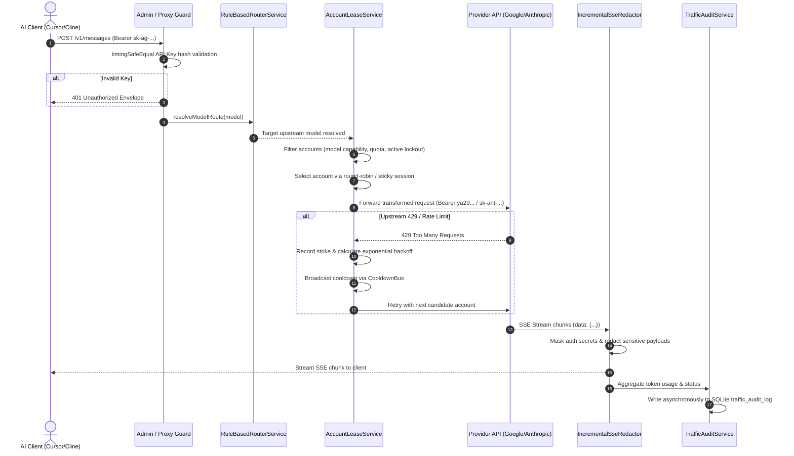
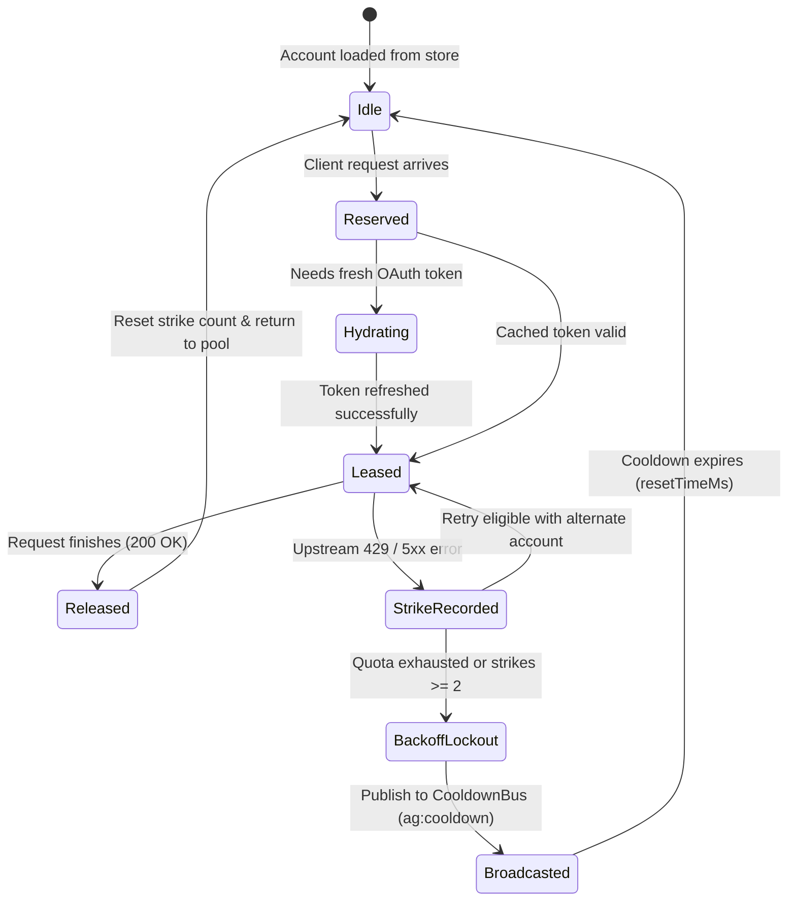

# LLM Gateway Proxy Architecture Guide

This document provides a comprehensive technical architecture reference for the **LLM Gateway Proxy** codebase. It is designed to onboard new contributors, explain end-to-end data flows, document key engineering decisions, and completely eliminate single-person dependency (Bus Factor = 1).

---

## 1. System Overview & Architecture Map

LLM Gateway Proxy is an ultra-low-latency, multi-protocol translation gateway and account rotation scheduler designed to interface modern AI coding assistants (Cursor, Claude Code, Cline, OpenCode) with upstream LLM providers (Google Cloud Code / Antigravity, Anthropic Claude, OpenAI, GitHub Copilot).

### High-Level Topology

```
┌───────────────────────────────────────────────────────────────┐
│                      Client Applications                      │
│        (Cursor, Claude Code, Cline, OpenCode, Web UI)         │
└───────────────────────────────┬───────────────────────────────┘
                                │ HTTP / SSE / WebSockets
                                ▼
┌───────────────────────────────────────────────────────────────┐
│               NestJS 10 + Fastify Gateway Core                │
│                                                               │
│   ┌────────────────────────┐      ┌───────────────────────┐   │
│   │ Authentication & Gate  │      │ Rule-Based Router     │   │
│   │ (AdminGuard / API Key) │      │ (Routing Engine)      │   │
│   └───────────┬────────────┘      └───────────┬───────────┘   │
│               │                               │               │
│               ▼                               ▼               │
│   ┌───────────────────────────────────────────────────────┐   │
│   │              Protocol Translation Layer               │   │
│   │  • Anthropic (/v1/messages)                           │   │
│   │  • OpenAI (/v1/chat/completions)                      │   │
│   │  • Gemini (/v1beta/models/...:generateContent)        │   │
│   └───────────────────────────┬───────────────────────────┘   │
│                               │                               │
│                               ▼                               │
│   ┌───────────────────────────────────────────────────────┐   │
│   │              Account Lease & Rotation                 │   │
│   │  • Candidate Filtering (Availability & Models)        │   │
│   │  • Round-Robin / Sticky Selection                     │   │
│   │  • Rate-Limit & Two-Strike 429 Cooldown               │   │
│   └───────────┬───────────────────────────────┬───────────┘   │
│               │                               │               │
│   ┌───────────▼────────────┐      ┌───────────▼───────────┐   │
│   │  Thought Signatures    │      │ Traffic Audit Sink    │   │
│   │  (LRU / CoT Retention) │      │ (Stream Redactor)     │   │
│   └────────────────────────┘      └───────────────────────┘   │
└───────────────┬───────────────────────────────┬───────────────┘
                │                               │
                ▼                               ▼
┌───────────────────────────────┐   ┌───────────────────────────┐
│      Storage & State          │   │    Upstream Providers     │
│ • SQLite (WAL Mode via TypeORM│   │ • Google Antigravity      │
│ • Atomic JSON Stores          │   │ • Anthropic API / Claude  │
│ • Opt-in Redis Cluster State  │   │ • OpenAI Platform         │
└───────────────────────────────┘   │ • GitHub Copilot          │
                                    └───────────────────────────┘
```

### Module Organization & Key Files

| Module / Layer | Primary Files | Responsibility |
|---|---|---|
| **Server Bootstrap & App Shell** | `src/server/main.ts`<br>`src/server/app.module.ts`<br>`src/server/server-config.ts` | Fastify initialization, static Web UI serving (`web/dist`), global pipes, and GraphQL setup. |
| **Proxy Gateway Core** | `src/modules/proxy-gateway/server/proxy.module.ts`<br>`src/modules/proxy-gateway/server/proxy.service.ts` | Root proxy container orchestrating all protocol modules, interceptors, and upstreams. |
| **Protocol Mappers** | `src/modules/proxy-gateway/antigravity/ClaudeRequestMapper.ts`<br>`src/modules/proxy-gateway/antigravity/ClaudeResponseMapper.ts`<br>`src/modules/proxy-gateway/antigravity/ModelMapping.ts`<br>`src/modules/proxy-gateway/server/modules/openai/openai.service.ts` | Request/response dialect normalization across OpenAI, Anthropic, and Gemini schemas. |
| **Account Lease & Scheduling** | `src/modules/proxy-gateway/server/modules/account-lease/account-lease.module.ts`<br>`src/modules/proxy-gateway/server/modules/account-lease/account-lease.service.ts` | Multi-account rotation, dynamic quota polling, and lease token issuance. |
| **Routing Engine** | `src/modules/proxy-gateway/routing/routing.module.ts`<br>`src/modules/proxy-gateway/routing/rule-based-router.service.ts` | Model alias resolution, upstream tier mapping, and custom traffic dispatch rules. |
| **Cloud Account & OAuth** | `src/modules/cloud-account/services/CloudAccountRefreshService.ts`<br>`src/modules/cloud-account/services/GoogleAPIService.ts`<br>`src/modules/cloud-account/services/OAuthClientRegistryService.ts` | Upstream OAuth token refresh, user info verification, and quota discovery. |
| **Security & API Keys** | `src/modules/api-key/api-key.module.ts`<br>`src/modules/api-key/api-key.service.ts`<br>`src/modules/proxy-gateway/server/guards/admin.guard.ts` | SHA-256 hashed dynamic API keys (`sk-ag-...`), timing-safe verification, and admin session gates. |
| **Audit & Observability** | `src/modules/proxy-gateway/audit/traffic-audit.service.ts`<br>`src/modules/proxy-gateway/audit/incremental-sse-redactor.ts`<br>`src/modules/proxy-gateway/audit/traffic-audit-http-metadata.ts` | Dual-mode traffic logging, incremental non-buffering SSE redaction, and usage aggregation. |
| **Thought Signatures** | `src/modules/proxy-gateway/antigravity/SignatureStore.ts`<br>`src/modules/proxy-gateway/thought-store/thought-store.service.ts` | In-memory preservation of chain-of-thought (CoT) tokens for Gemini 2.0 / 3.0 Thinking models. |
| **Persistence & Redis** | `src/shared/persistence/atomic-json-file.ts`<br>`src/shared/persistence/durable-record-store.ts`<br>`src/shared/persistence/redis-client.ts` | Atomic POSIX writes, durable key-value stores, and opt-in multi-node Redis clustering. |

---

## 2. Request Lifecycle & Routing Pipelines

Requests pass through an ordered sequence of guards, routing policies, account leasing, upstream dispatch, and response transformation.

### Sequence Flow Diagram



### Protocol Conversion Details

1. **Anthropic (`POST /v1/messages`)**:
   - `ClaudeRequestMapper.ts` parses input `messages`, `system` prompts, and tool specifications.
   - Converts Claude messages into Google Antigravity Gemini requests (`contents`, `generationConfig`, `tools`).
   - `ClaudeResponseMapper.ts` converts upstream response chunks into Anthropic SSE stream events (`message_start`, `content_block_delta`, `message_delta`, `message_stop`).
2. **OpenAI (`POST /v1/chat/completions`)**:
   - Handled by `src/modules/proxy-gateway/server/modules/openai/openai.service.ts`.
   - Maps OpenAI tool calls, function calls, and multi-turn messages to upstream provider format.
   - Emits standard OpenAI SSE chunks with finish reasons (`stop`, `tool_calls`, `length`).
3. **Gemini Native (`POST /v1beta/models/:model:generateContent`)**:
   - Passthrough with header injection, lease token authentication, and response stream monitoring.

---

## 3. Account Lease Lifecycle & State Machine

Account pooling and leasing ensures seamless high-availability across multiple cloud credentials without running into upstream rate limits.

### Lease State Machine



### Key Policies

- **Model Capability Check** (`account-lease-model.policy.ts`): Ensures only accounts authorized or confirmed to support the target model family receive requests.
- **Rate-Limit Enforcement** (`account-lease-limit.policy.ts`): Enforces in-memory lockout deadlines (`RateLimitTrackerService`). Accounts in cooldown are excluded before round-robin tie-breaking.
- **Round-Robin Selection** (`account-lease-selection.policy.ts`): Balances requests evenly across active, healthy accounts. Supports sticky sessions when `session_id` is supplied.
- **Token Hydration** (`CloudAccountRefreshService.ts`): Refreshes expired OAuth access tokens (`ya29...`) using client credentials managed by `OAuthClientRegistryService.ts`.

---

## 4. Thought Signature Preservation Design

Reasoning models (such as Gemini 2.0 Flash Thinking, Gemini 3.0, and Claude Thinking) generate internal chain-of-thought (CoT) traces. Upstream APIs strictly require previous thought tokens or cryptographically signed thought signatures (`thought_signature`) when continuing multi-turn conversations with tool calls.

### Storage & Recovery Mechanics

1. **`SignatureStore.ts`**:
   - Maintains an in-memory session-scoped LRU bucket (`MAX_SESSION_ENTRIES = 500`, TTL 1 hour).
   - Signatures are indexed by `(sessionKey, messageCount, toolCallId)` to prevent cross-client signature pollution.
2. **`ThoughtSignatureCompat.ts`**:
   - Intercepts outgoing client requests.
   - If an assistant message with tool calls lacks a valid thought signature, retrieves the matching cached signature from `SignatureStore` and injects it before forwarding to the upstream API.
3. **`OfficialSystemInstruction.ts`**:
   - Preserves system instructions and thoughts formatting rules so reasoning models adhere to strict XML output standards.

---

## 5. Audit Logging & SSE Reconstruction Pipeline

Every inference transaction and management operation is audited for operational security and token accounting without degrading proxy throughput.

### Pipeline Components

```
Upstream SSE Stream ──► IncrementalSseRedactor ──► Streaming Response to Client
                             │
                             ├─► Redact Auth Tokens & PII
                             ├─► Reconstruct Finish Reason & Content
                             └─► Calculate Token & Cost Usage (audit-usage.ts)
                                       │
                                       ▼
                             TrafficAuditService
                                       │ (debounced batch write)
                                       ▼
                             SQLite traffic_audit_log
```

- **Zero-Buffer Streaming**: `IncrementalSseRedactor.ts` operates on sliding text chunks. Multi-megabyte reasoning streams are never buffered in whole memory before sending to clients.
- **Header & Token Sanitization**: Sensitive authorization headers (`Authorization`, `x-api-key`, `cookie`) are redacted via `src/shared/security/sensitiveDataMasking.ts` before database persistence.
- **Cost Estimation**: `model-pricing-catalog.ts` maps input/output token counts against prompt caching discounts to provide real-time operational costs in the Web UI dashboard.

---

## 6. Storage Layer & Persistence Architecture

The gateway uses a hybrid storage architecture designed for absolute data safety and optional horizontal scaling:

1. **SQLite Database (`llm-gateway.db`)**:
   - Configured via `src/modules/database/database.config.ts`.
   - **WAL Mode (`PRAGMA journal_mode=WAL;`)**: Enables concurrent readers without blocking writes.
   - **Busy Timeout (`PRAGMA busy_timeout=5000;`)**: Prevents transient SQLite lock contention errors under load.
   - Manages: Dynamic API keys (`ApiKey` entity) and traffic audit records (`TrafficLog` entity).
2. **Atomic JSON File Persistence**:
   - Handled by `src/shared/persistence/atomic-json-file.ts`.
   - Writes first to a temporary sibling file (`.tmp.<pid>.<timestamp>`) and executes an atomic POSIX `fs.rename`.
   - Prevents file corruption during unexpected power outages or container terminations.
   - Powers `accounts.json`, `routing.json`, and `durable-record-store.ts`.
3. **Opt-in Redis Multi-Node State Sharing (`REDIS_URL`)**:
   - Managed via `src/shared/persistence/redis-client.ts`.
   - **Lazy Loading**: `ioredis` is dynamically imported only if `REDIS_URL` is set in the environment. Single-node deployments carry zero Redis overhead.
   - **Token Store**: `RedisAccountLeaseTokenStore.ts` stores OAuth access tokens with TTL matching token expiry (`ag:lease:token:<accountId>`).
   - **Cooldown Bus**: `RedisCooldownBus.ts` broadcasts rate-limit lockouts across cluster nodes on channel `ag:cooldown`. Nodes ignore self-broadcast events using unique `nodeId` identifiers.

---

## 7. Security Model & Authentication Constraints

Security in the LLM Gateway Proxy is enforced through multiple defensive layers:

- **Loopback Discovery**: `GET /v1/models` is intentionally open to allow editor extensions (Cursor, Cline) to fetch model lists without requiring pre-configured credentials.
- **Admin Gate & Dashboard**: All `/internal/*` routes and `/graphql` are guarded by `AdminGuard` (`src/modules/proxy-gateway/server/guards/admin.guard.ts`).
- **Timing-Safe Equality**: All credential validations (Admin keys, Dynamic API keys, Web UI passwords) use `crypto.timingSafeEqual` over SHA-256 digests to prevent side-channel timing attacks.
- **API Key Secrecy**: Raw API keys (`sk-ag-...`) are generated cryptographically and presented to the user **exactly once** upon creation. All queries and list APIs return masked values (`sk-ag-xx...xxxx`).
- **CSRF / Session Hardening**: Admin sessions use cryptographically random session tokens with secure cookie configurations.

---

## 8. Configuration Reference

All settings can be configured via environment variables or `.env` files:

| Environment Variable | Default Value | Description |
|---|---|---|
| `PORT` | `8080` | Port for the Gateway Proxy backend. |
| `HOST` | `127.0.0.1` | Network interface binding (`0.0.0.0` for containerized environments). |
| `INITIAL_ADMIN_KEY` | *(Generated on first boot)* | Bootstrap administrative key for dashboard login and `/internal` endpoints. |
| `SESSION_SECRET` | *(Auto-generated)* | Cryptographic salt for session cookie signing. |
| `DATA_DIR` | `./data` | Directory housing SQLite databases and atomic JSON configuration files. |
| `ACCOUNTS_PATH` | `./data/accounts.json` | Path to upstream cloud accounts registry. |
| `DATABASE_PATH` | `./data/llm-gateway.db` | Path to SQLite database file. |
| `REDIS_URL` | *None (Unset)* | Redis connection string (e.g., `redis://127.0.0.1:6379`) for multi-node state sharing. |
| `LOG_LEVEL` | `info` | Logging verbosity (`debug`, `info`, `warn`, `error`). |

---

## 9. Test Architecture & Quality Gates

The project maintains a rigorous, multi-layered automated test suite:

```
                  ┌──────────────────────┐
                  │ 24 Playwright Tests  │  Browser E2E (Web UI, i18n, Auth)
                  └──────────┬───────────┘
                             │
                  ┌──────────▼───────────┐
                  │   27 Jest E2E Tests  │  API Level (Nock HTTP + Temp SQLite)
                  └──────────┬───────────┘
                             │
                  ┌──────────▼───────────┐
                  │  981 Jest Unit Tests │  Protocol Mappers, Policies, Stores
                  └──────────────────────┘
```

### Running Test Layers

```bash
# Unit test suite with coverage
npm run test:unit
npm run test:unit -- --coverage

# E2E API integration suite (isolated ephemeral databases)
npm run test:e2e

# Playwright browser suite (headless Chromium)
npm run test:playwright

# Strict static checks
npm run type-check   # Must return 0 errors
npm run lint         # Oxlint - must return 0 warnings/errors
```

### Testing Constraints & Conventions

1. **Ephemeral Databases**: All tests must use temporary SQLite files (`/tmp/`) or in-memory stores. Production files in `data/` must never be touched.
2. **Network Isolation**: Upstream provider calls must be mocked using `nock` or Jest spies. Tests must never make live network calls to external Google or Anthropic servers.
3. **Playwright Scoping**: Sidebar button clicks must always be scoped to navigation landmarks (`page.getByRole('navigation')`) to ensure strict selector compatibility across English and Vietnamese locales.

---

## 10. Operational Runbook & Disaster Recovery

### Common Operational Scenarios

#### 1. Upstream 429 Rate Limit Cooldowns
- **Symptom**: Logs display `[RateLimitTrackerService] Account acc-xxx marked as rate-limited`.
- **Behavior**: The scheduler automatically fails over to remaining healthy accounts in the pool.
- **Recovery**: Lockouts expire automatically based on upstream `retry-after` headers (capped at 300s). In multi-node setups with `REDIS_URL`, lockouts propagate instantly across all gateway instances.

#### 2. OAuth Token Refresh Failure (`invalid_grant`)
- **Symptom**: Account status changes to `requires_action` or `refresh_blocked`.
- **Cause**: Upstream refresh token expired, user revoked application permissions, or password changed.
- **Resolution**: Re-authenticate the account via CLI wizard (`npm run add-account`) or Web UI dashboard.

#### 3. Redis Disconnection in Multi-Node Setup
- **Symptom**: Warning in logs: `[CooldownBus] Failed to publish cooldown to Redis`.
- **Behavior**: Gateway automatically degrades to local in-memory lockouts and local token store. No user requests are dropped.
- **Resolution**: Restore Redis connectivity. The lazy client automatically reconnects.

#### 4. SQLite Contention / Locked Database
- **Symptom**: Error `SQLITE_BUSY: database is locked`.
- **Verification**: Ensure WAL mode is active (`PRAGMA journal_mode;` returns `wal`). The built-in `busy_timeout` is set to 5000ms. If running on network filesystems (NFS), move `llm-gateway.db` to local SSD storage.
